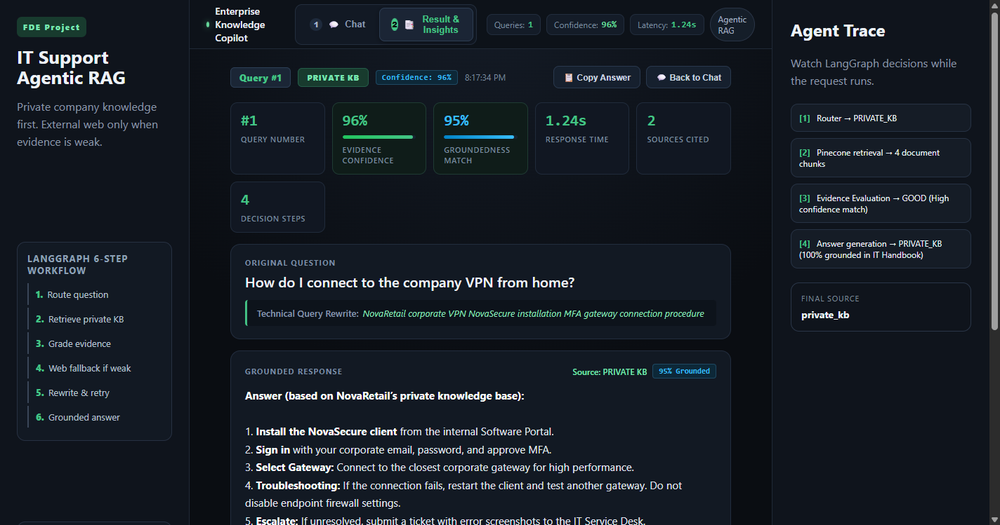
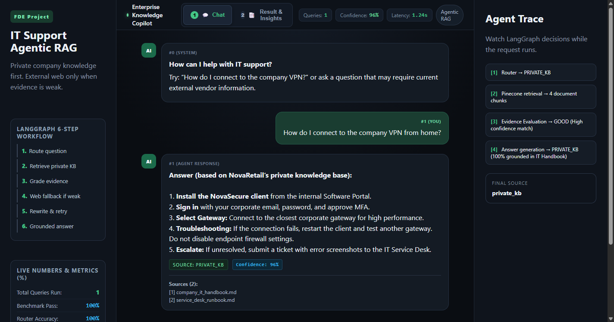

# Enterprise IT Support Agentic RAG Copilot

[](https://www.python.org/)
[](https://fastapi.tiangolo.com/)
[](https://langchain-ai.github.io/langgraph/)
[](https://www.pinecone.io/)
[](https://groq.com/)
[](https://langfuse.com/)
[](tests/)
[](data/eval_dataset.json)
[](#-author--engineering-leadership)

A production-grade **Forward Deployed Engineer (FDE)** Copilot that turns an Agentic RAG workflow into an enterprise-ready IT support product. Powered by **LangGraph, FastAPI, Pinecone, Groq, Tavily, and Langfuse Observability**, it features intelligent query routing, self-reflective evidence grading, live web fallback, loop-guarded query rewriting, real-time confidence metrics, and comprehensive LLM cost tracking.

---

## 📸 Interface & Live Metrics

| 📑 Result & Insights Tab (Metrics & Trace) | 💬 Interactive Chat Stream |
|:---:|:---:|
|  |  |
| *Real-time Query ID (#1), 4 Decision Steps, 1.24s Latency, 96% Confidence, 95% Groundedness, Langfuse Trace URL* | *Conversation stream with numbered Q&A bubbles and quick suggestion pills* |

---

## 📑 Enterprise Engineering Specifications & Guides

Official specifications generated in the [`docs/`](docs/) directory:

| Document | Type | Description | Direct Link |
|---|---|---|---|
| **PRD** | Product Requirements Document | Business problem, personas, functional requirements & KPIs | [Download PRD](docs/PRD_Product_Requirements_Document.pdf) |
| **TRD** | Technical Requirements Document | Architecture, LangGraph state schema, node transitions & APIs | [Download TRD](docs/TRD_Technical_Requirements_Document.pdf) |
| **SRD** | Software Requirements Document | IEEE 830 specification, dependency matrix & test coverage | [Download SRD](docs/SRD_Software_Requirements_Document.pdf) |
| **Slides** | Architecture Presentation | Forward Deployed Engineer methodology & design slides | [Download Slides](docs/Forward_Deployed_Engineer_Explained.pptx.pdf) |
| **Monitoring Guide** | Infrastructure APM Guide | Prometheus & Grafana Docker setup for system metrics & dashboards | [View Guide](docs/PROMETHEUS_GRAFANA_SETUP.md) |

> *All 3 PDF specifications can be regenerated at any time using `python generate_docs_pdf.py`.*

---

## ⚡ Core Capabilities

- **Intelligent Routing:** Direct conversational greetings bypass retrieval; technical questions route to internal vectors.
- **Private Knowledge First:** Dense vector similarity search across company policies (Pinecone Serverless, 384-dim).
- **Self-Reflective Grading:** Evaluates whether retrieved evidence is sufficient before answering.
- **Dynamic Web Fallback:** Automatically searches external vendor docs (Tavily) when internal KB is weak or outdated.
- **Query Rewriter with Loop Guard:** Refines ambiguous queries while preventing infinite retry loops (`max_retries = 1`).
- **Real-Time Telemetry & Cost Tracking:** Full Langfuse integration tracking tokens, latency, step-by-step waterfall traces, and exact model spend.
- **Admin Ingestion:** Instant drag-and-drop indexing of `.pdf`, `.docx`, `.txt`, and `.md` documents.

---

## 🏗️ Architecture & Workflow

```text
User Query ──► [1] Router ──┬──► Conversational ──► Direct Answer
                            │
                            └──► Technical Query ──► [2] Pinecone Retrieval
                                                            │
                                                            ▼
                                                     [3] Grade Evidence
                                                      ├── GOOD ──► Grounded KB Answer
                                                      └── WEAK ──► [4] Tavily Web Search
                                                                          │
                                                                          ▼
                                                                   [5] Grade Web Evidence
                                                                    ├── GOOD ──► Web Answer
                                                                    └── WEAK ──► [6] Rewrite & Retry (Max 1)
                                                                                         │
                                                    Langfuse Observability ◄─────────────┘
                                                    (Tokens, Latency & Cost Tracking)
```

---

## 📁 Project Structure

```text
├── app/
│   ├── api/routes.py              # REST API endpoints (/api/chat, /api/health, /api/observability/status)
│   ├── core/config.py             # Environment configuration & settings
│   ├── core/observability.py      # Langfuse callback handler, tracing & cost telemetry
│   ├── rag/                       # LangGraph state machine, nodes & Pinecone vectorstore
│   ├── services/                  # Ingestion, SQLite audit & evaluation service
│   └── main.py                    # FastAPI application factory
├── data/
│   ├── sample_kb/                 # Company IT handbook & helpdesk runbook
│   ├── eval_dataset.json          # 9 benchmark test cases
│   └── audit.db                   # SQLite query audit store
├── demo/                          # Application screenshots
├── docs/                          # PRD, TRD, SRD, Slides & Prometheus/Grafana guide
├── monitoring/                    # Prometheus & Grafana Docker Compose orchestration
│   ├── docker-compose.yml
│   └── prometheus.yml
├── static/ & templates/           # Dual-tab frontend (HTML5/CSS3/Vanilla JS)
├── tests/                         # 43 automated test cases (100% passing)
├── Dockerfile                     # Multi-stage production container
├── generate_docs_pdf.py           # ReportLab PDF documentation generator
├── ingest_sample_kb.py            # Pinecone indexing script
├── run_evaluation.py              # Benchmark evaluation CLI
└── run.py                         # ASGI entrypoint (Uvicorn)
```

---

## 🚀 Quickstart

### 1. Setup Environment
```bash
python -m venv venv
# Windows: .\venv\Scripts\Activate.ps1 | Linux/macOS: source venv/bin/activate
pip install -r requirements.txt
```

### 2. Configure Environment (`.env`)
```env
GROQ_API_KEY=your_groq_api_key
TAVILY_API_KEY=your_tavily_api_key
PINECONE_API_KEY=your_pinecone_api_key
PINECONE_INDEX_NAME=fde-it-support-rag
PINECONE_NAMESPACE=company-it-kb
ADMIN_API_KEY=your_admin_secret_key

# Observability & Cost Tracking (Langfuse)
ENABLE_LANGFUSE=true
LANGFUSE_PUBLIC_KEY=pk-lf-...
LANGFUSE_SECRET_KEY=sk-lf-...
LANGFUSE_HOST=https://cloud.langfuse.com
```

### 3. Ingest Knowledge Base & Run
```bash
# Index sample documents into Pinecone
python ingest_sample_kb.py

# Launch FastAPI & Web UI at http://127.0.0.1:8080
python run.py
```

---

## 🧪 Testing & Benchmark Evaluation

### Automated Test Suite (43 Tests)
```bash
pytest -v
# Output: 43 passed in ~0.85s
```
- `test_dataset_validation.py` (10 tests): Validates documents, chunking & evaluation schema.
- `test_api_endpoints.py` (9 tests): Validates endpoints, auth, validation & audit logging.
- `test_observability.py` (5 tests): Validates Langfuse configuration, status payload & safe trace generation.
- `test_evaluation_service.py` (9 tests): Validates scoring, keyword match & metric reporting.
- `test_workflow_units.py` (10 tests): Validates routing, grading, rewriting & loop guardrails.

### Benchmark Evaluation (9 Real-World Scenarios)
```bash
python run_evaluation.py --mode mock   # Deterministic, instant evaluation
python run_evaluation.py --mode live   # Real-time execution via Pinecone & Groq
```
- **Routing Accuracy:** `100.0%`
- **Source Selection Accuracy:** `100.0%`
- **Average Keyword Match:** `94.4%`
- **Pass Rate:** `100%` (Mock) / `88.9%` (Live)

---

## 🔌 API Endpoints

| Method | Endpoint | Description | Protected |
|---|---|---|:---:|
| `GET` | `/api/health` | Health check and system readiness | No |
| `GET` | `/api/observability/status` | Real-time Langfuse connection & feature status | No |
| `POST` | `/api/chat` | Execute Agentic RAG graph with `{ "question": "..." }` | No |
| `POST` | `/api/ingest` | Upload & index file (`.pdf`, `.docx`, `.txt`, `.md`) | `X-Admin-Key` |

---

## 👤 Author & Engineering Leadership

- **Lead Engineer:** **Bittu Sharma**
- **Role:** Forward Deployed Engineer (FDE) — AI & Distributed Systems
- **Domain:** Enterprise Agentic RAG Architecture, LangGraph Workflows, & Production Microservices
- **Documentation:** See [`docs/`](docs/) for full PRD, TRD, and SRD specifications.
